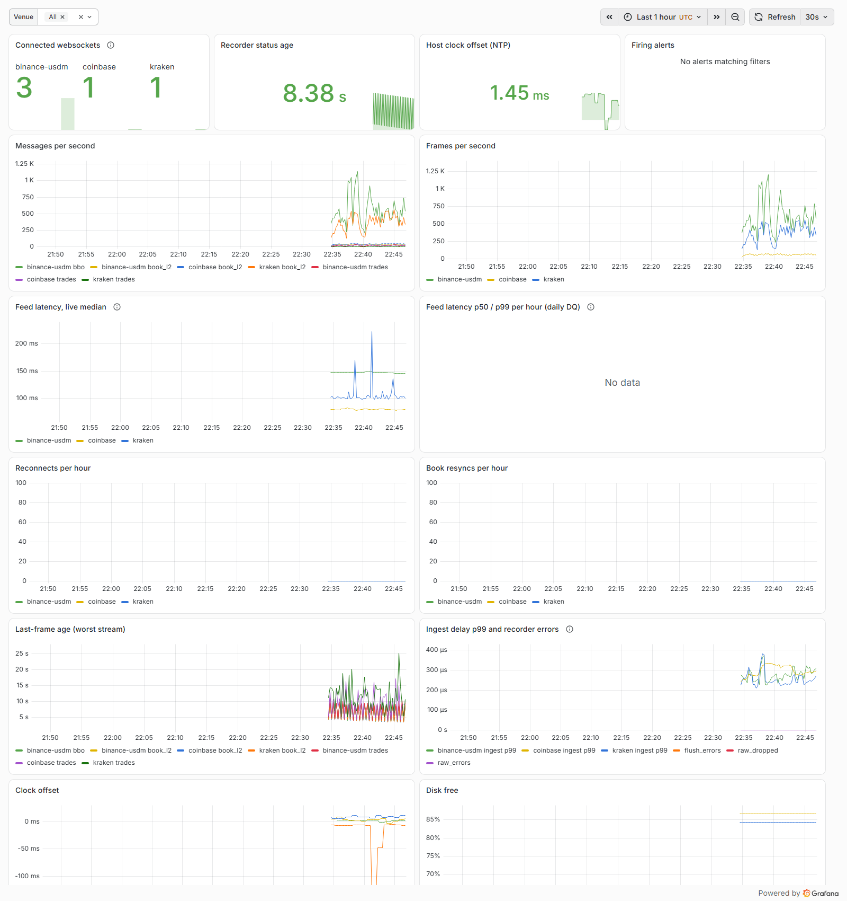
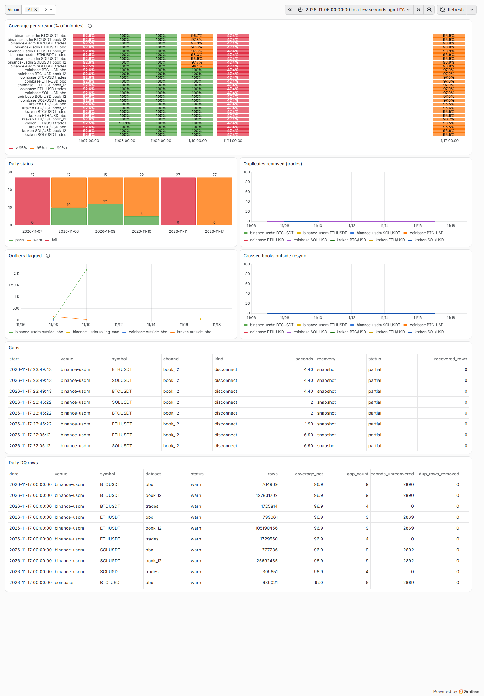

# Monitoring

`make up` starts ClickHouse, Prometheus, Grafana and the **tickdb exporter**. Every port is
bound to 127.0.0.1, and the exporter isn't published at all.

## The exporter

This project records nothing itself: the one shared crypto capture (crypto-lob-alpha's
recorder) does. So the target Prometheus scrapes as the "ingestor" (`job="tickdb-ingest"`,
`instance="shared-capture"`) is `tickdb exporter`. At each scrape it reads the recorder's
`status.json` read-only. The recorder rewrites that file about every 10 s; the exporter keeps
no state between scrapes. The exporter also:

- probes the host clock over NTP every 60 s (FR-21) and appends each reading to
  `meta/clock/date=D.jsonl` for the DQ checks;
- reports free space of the data root, of the host drive whose 150 GB floor the owner set
  (`/mnt/g`, read-only mount) and of the capture's disk;
- reports the last outcome of the hourly mirror and of the daily job.

| Metric | Labels | From |
|---|---|---|
| `tickdb_capture_status_up`, `tickdb_capture_status_age_seconds`, `tickdb_capture_stopped` | | status file |
| `tickdb_ws_connected` | venue | open connections; 0 while the status is older than 60 s |
| `tickdb_ws_connection_generation` | venue, group | changes on every reconnect (`changes()` = reconnects) |
| `tickdb_ws_frames_total`, `tickdb_parse_errors_total` | venue | recorder counters |
| `tickdb_stream_messages_total`, `tickdb_last_frame_age_seconds`, `tickdb_stream_live` | venue, symbol, channel | per stream |
| `tickdb_resyncs_total`, `tickdb_crossed_books_total` | venue, symbol | book streams |
| `tickdb_feed_latency_p50_seconds` | venue | recorder's running median of `ts_recv - ts_exchange` |
| `tickdb_ingest_delay_p99_seconds`, `tickdb_capture_errors_total` | venue / kind | in place of a queue depth, which the recorder doesn't export |
| `tickdb_venue_clock_offset_seconds` | venue | recorder's estimate against venue server time |
| `tickdb_clock_offset_seconds`, `tickdb_clock_probe_delay_seconds`, `tickdb_clock_probe_failures_total` | | this exporter's NTP probe |
| `tickdb_disk_free_bytes`, `tickdb_disk_free_ratio` | path (`data_root`, `guard`, `capture`) | statvfs and the status file |
| `tickdb_job_last_run_timestamp`, `tickdb_job_last_run_ok` | job, venue | `meta/mirror/run.log`, `meta/scheduler/job_log.csv` |

## Dashboards

Both dashboards are generated by `scripts/gen_dashboards.py` (`make dashboards`) into
`docker/grafana/dashboards/` and provisioned read-only. CI checks that the committed JSON matches
the generator.

- **Feed health** (Prometheus, plus `dq_latency` in ClickHouse). Panels:
    - connected websockets, recorder status age, host clock offset, firing alerts;
    - messages and frames per second;
    - feed latency: the live median, and p50/p99 per hour from the daily DQ;
    - reconnects and resyncs per hour;
    - worst last-frame age;
    - ingest delay p99 and recorder errors;
    - clock offsets, disk free, last job runs.
- **Data quality** (ClickHouse, read-only user `tickdb_ro`). Panels:
    - coverage per stream and day;
    - daily status counts;
    - duplicates removed, outliers and crossed books;
    - the gap table;
    - every `dq_daily` row.

Screenshots from 2026-11-18. They were taken from a throwaway local Grafana with the same
provisioning and anonymous viewer access, which was removed afterwards; the stack's own Grafana
keeps anonymous access off.





## Alerts (FR-20)

`docker/prometheus/rules/tickdb.rules.yml`. CI runs `promtool check config` and the unit tests
in `docker/prometheus/tests/rules_test.yml`. Firing alerts show in the Feed health dashboard;
delivering notifications is out of scope.

| Alert | Condition |
|---|---|
| TickdbExporterDown | the exporter target is down for 2 min |
| TickdbIngestorDown | recorder status older than 120 s, or the recorder stopped |
| TickdbVenueDisconnected | no open connection for a venue for 2 min |
| TickdbNoFrames | a book stream without a frame for over 60 s |
| TickdbFeedLatencyHigh | latency median above 1 s for 10 min (see below) |
| TickdbResyncsHigh | more than 10 book resyncs in an hour |
| TickdbClockOffset | NTP offset above 50 ms for 5 min |
| TickdbDiskFreeLow | under 15 % free on any watched path for 5 min |
| TickdbGuardFloor | host drive under 150 GB free for 5 min |
| TickdbDailyJobFailed / TickdbDailyJobLate | the last daily run failed, or none for 26 h |
| TickdbMirrorFailed | the last mirror run failed, or none for 2 h |

**Latency alert on the median.** The shared recorder publishes a running median of feed
latency but no p99, so the live alert uses the median. The p99 is computed per hour from the
archive by the daily DQ checks and shown in both dashboards. This is a documented deviation
from FR-20's "p99 > 1 s for 10 min" (docs/decisions.md, M5).

## Checking it (AC-W-09)

```bash
make check-monitoring
```

The check runs, and exits 1 if any part fails:

- Prometheus `/api/v1/targets`: every `tickdb-ingest` target is up.
- Prometheus `/api/v1/rules`: at least 12 rules, all with health `ok`.
- Grafana `/api/search`: both dashboards are provisioned.
- Grafana `/api/ds/query`: every panel query of both dashboards runs over the dashboard's time range with no error.
- ClickHouse: `dq_daily` has rows for yesterday.

It prints a JSON summary. The Grafana admin password comes from `.env` and is never printed.
